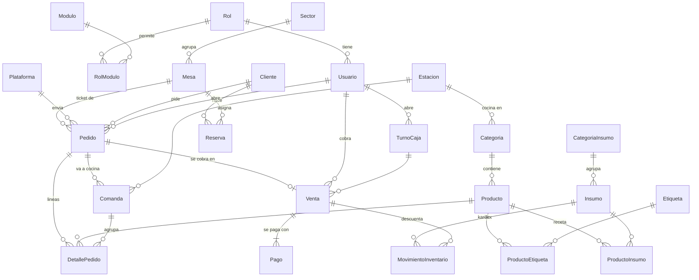

# RestoOS — Análisis y diseño de la base de datos (SQL Server)

Script: [`RestoOS_SQLServer.sql`](RestoOS_SQLServer.sql) · Motor: Microsoft SQL Server 2017 o superior (Express o LocalDB).

> **Estado (noviembre 2026):** la app WinForms ya usa esta base. La crea sola la primera vez y todos los "Store"
> de `Data/` leen y escriben en SQL Server. Solo KDS y Delivery siguen con datos de demostración. Detalle en la
> [sección 11](#11-integración-con-la-app).

## 1. Objetivo

Reemplazar los archivos sueltos que hoy usa la app WinForms (`.xml` y `.dat`) y los datos de demostración en memoria
por una base de datos relacional única, que:

- guarde de verdad todo lo que la interfaz ya permite hacer (carta, mesas, tickets, cobros, inventario, reservas, delivery);
- cubra los requisitos de `requisitos-app-restaurante.md` que la UI todavía no tiene (usuarios y roles, pago dividido/mixto,
  anulación con supervisor, arqueo de caja, propina, descuentos);
- haga cumplir las reglas del negocio en la propia base (restricciones y transacciones), no solo en los formularios.

## 2. Cómo guardaba los datos la app antes de la base

| Dato | Dónde vivía | Clase |
|---|---|---|
| Carta: categorías y platos, precios, recetas | `data/menu.xml` (ruta relativa al .exe) | `MenuStore`, `Category`, `MenuItem`, `InsumoLink` |
| Mesas del salón | `%LocalAppData%\RestoOS\mesas.dat` (`nombre\|sector\|capacidad\|estado\|total\|abrir`) | `MesaStore`, `MesaInfo` |
| Tickets abiertos por mesa | `%LocalAppData%\RestoOS\tickets.dat` (`mesa\|producto\|categoría\|precio\|cantidad\|notas`) | `TicketStore`, `OrderLine`, `Product` |
| Módulos activos | `%LocalAppData%\RestoOS\modules.dat` (`clave=1/0`) | `ModuleStore` |
| Datos del negocio e impuesto | `settings.xml` y `tax.dat` | `LocalSettings`, `SettingsForm` |
| Historial de pedidos | `orders.xml` | `OrderHistoryStore`, `OrderRecord` |
| Cocina (KDS), Inventario, Reservas, Delivery | **solo en memoria**, datos de ejemplo fijos | `KdsOrder`, `Insumo`, `Reserva`, `PedidoDelivery` |
| Ventas para Reportes | **generadas al azar** en `ReportesForm` | `Venta`, `VentaItem` |
| Usuarios | No existen: perfil "Admin" con PIN fijo `1234` en `AdminCodeForm`, o "Empleado" sin PIN | `LoginForm` |

## 3. Hallazgos del análisis y cómo quedaron

| # | Hallazgo | Solución en la base | Estado en la app |
|---|---|---|---|
| 1 | **Las ventas no se guardaban.** El POS cobraba y vaciaba el ticket sin registrar nada; Reportes mostraba 30 días de ventas aleatorias. | `Venta`, `Pago`, `MovimientoInventario` y `sp_CobrarPedido`, que hace todo el cobro en una transacción. | **Corregido.** El POS cobra con `VentaStore.Cobrar`; el recibo trae el N.º de venta y avisa si un insumo quedó en stock bajo. Reportes e Historial leen ventas reales. |
| 2 | **Impuesto calculado de dos formas.** `PosForm` lo **sumaba** al subtotal y `Venta.TaxAmount()` lo trataba como **incluido**. | `Venta` guarda `Subtotal`, `ImpuestoPorcentaje` e `ImpuestoValor`; el impuesto se suma. | **Corregido.** POS y base usan el mismo cálculo (`VentaStore.CalcularImpuesto`, mismo redondeo que SQL); Reportes muestra el impuesto guardado. |
| 3 | **Todo se enlazaba por nombre** (ticket ↔ mesa, receta ↔ insumo, línea ↔ plato). Renombrar rompía el vínculo. | Llaves foráneas por Id. | **Corregido.** Mesas, platos y categorías llevan su Id de la base (`MesaInfo.Id`, `MenuItem.DbId`, `Product.ProductoId`). Renombrar una mesa ya no mueve tickets a mano. |
| 4 | **Unidades duplicadas:** `InsumoLink` traía su propia unidad. | La unidad vive solo en `Insumo`. | **Corregido.** Al publicar la carta, 250 g se guardan como 0,25 kg si el insumo está en kg. Las unidades se validan (`kg, g, L, ml, und`). |
| 5 | **Tipos guardados como texto** (`"4 personas"`, stock `-1`). | `Capacidad TINYINT`, `PorcionesDia NULL` = ilimitado. | **Corregido** (la UI sigue mostrando "4 personas"). |
| 6 | **Datos de domicilio perdidos.** | `Cliente` y `Pedido.DireccionEntrega`. | **Corregido.** El cobro a domicilio guarda o reutiliza el cliente (nombre + teléfono) y la dirección. |
| 7 | **Estación de cocina sin dueño.** | `Categoria.EstacionId` y `sp_EnviarComandas`. | Pendiente en la UI: el KDS sigue en modo DEMO. |
| 8 | **Datos sin uso** (`IsFavorite`, `InventoryDiscount`, `Variants`, `ItemIds`, `MockTotal`). | No se migran. | Las propiedades siguen en los modelos pero ya no se guardan. |
| 9 | **PIN de administrador fijo** (`1234` en el código) y empleados sin PIN. | `Usuario` con PIN cifrado, `sp_ValidarPin`. | **Corregido.** Ambos perfiles piden PIN y la sesión guarda quién cobra (`Data/Sesion`). |

## 4. Nota sobre el motor: SQL Server frente a SQLite

Los requisitos (§5) recomiendan SQLite porque no exige instalar un motor. Con SQL Server hay que tener en cuenta:

- **A favor:** resuelve de forma nativa el escenario multi-terminal de §5 (una máquina servidor y varias cajas/KDS por la
  red local) sin construir una API propia; trae transacciones, respaldos programables y usuarios de base de datos.
- **En contra:** cada negocio debe instalar SQL Server Express (gratuito, límite de 10 GB por base, de sobra para un
  restaurante) o LocalDB para una sola caja. Esto choca con "instalar y listo", aunque el instalador puede incluirlo.
- La compatibilidad con Windows 8 ya se perdió al pasar a .NET 8, así que SQL Server no empeora ese punto.

El diseño usa tipos y restricciones estándar; si más adelante se vuelve a SQLite, el modelo de tablas sirve casi igual.

## 5. Modelo de datos

25 tablas en 6 grupos:

| Grupo | Tablas |
|---|---|
| Configuración | `Configuracion` (una sola fila), `Modulo` |
| Seguridad | `Rol`, `Usuario`, `RolModulo` (qué secciones ve cada rol) |
| Salón | `Sector`, `Mesa` |
| Menú digital | `Estacion`, `Categoria`, `Producto`, `Etiqueta`, `ProductoEtiqueta` |
| Inventario | `CategoriaInsumo`, `Insumo`, `ProductoInsumo` (receta), `MovimientoInventario` (kárdex) |
| Operación | `Cliente`, `Reserva`, `Plataforma`, `Pedido`, `DetallePedido`, `Comanda`, `TurnoCaja`, `Venta`, `Pago` |



### Ciclo de un pedido

1. Con el primer producto de un ticket se crea un `Pedido` en estado `Abierto` (como "Salón"; al cobrar se fija si fue
   para llevar o a domicilio).
   Un índice único impide dos pedidos abiertos en la misma mesa (igual que `TicketStore`).
2. Cada plato agregado es una fila de `DetallePedido` que **copia el nombre y el precio** del producto: si mañana cambia
   la carta, las ventas pasadas no cambian.
3. `sp_EnviarComandas` crea una `Comanda` por estación con las líneas aún no enviadas (KDS).
4. `sp_CobrarPedido` crea la `Venta` y uno o varios `Pago` (efectivo y/o tarjeta), descuenta insumos y porciones del día,
   cierra el pedido y deja la mesa en "Por limpiar". Si algo falla, no queda nada a medias.
5. `sp_AnularVenta` marca la venta como anulada, exige un administrador distinto al cajero y un motivo, y devuelve los
   insumos al inventario con movimientos de tipo "Anulación".

### Decisiones de diseño

- **Llaves `INT IDENTITY`** en todas las tablas (más legibles y livianas para los índices). La app conserva su `Guid`
  interno en `Category` y `MenuItem` para no tocar el Menú digital, y guarda al lado el Id de la base (`DbId`).
- **Textos `NVARCHAR`** (tildes y ñ) y **dinero `DECIMAL`**, nunca `float`.
- **Intercalación `Modern_Spanish_CI_AS`**: sin distinguir mayúsculas pero **sí tildes**. Los estados se validan con
  `CHECK` usando exactamente los textos de la app (`"Salón"`, `"Cuenta pedida"`, `"En preparación"`...), así que C#
  debe enviarlos idénticos.
- **Columnas calculadas** para lo que hoy calcula el modelo: `Insumo.Estado` (OK / Bajo / Crítico, misma regla que la app),
  `DetallePedido.Subtotal`, `Pago.Cambio`, `TurnoCaja.Diferencia`.
- **Baja lógica** (`Activo`/`Activa`) en mesas, categorías, productos, insumos y usuarios: no se pueden borrar si ya hay
  ventas que los referencian. Si se crea algo con el nombre de un registro dado de baja, la app reactiva la mesa o el
  insumo, o renombra el plato/categoría viejo con el sufijo `[baja N]` para liberar el nombre.
- **PIN con hash**: `Usuario` guarda SHA-256 de (sal aleatoria + PIN), nunca el PIN. `sp_GuardarPin` lo asigna y
  `sp_ValidarPin` lo comprueba, así C# no necesita implementar el hash.

## 6. De la app a la base de datos

| App (clase / archivo) | Tabla |
|---|---|
| `settings.xml`, `tax.dat` | `Configuracion` |
| `ModuleStore` / `modules.dat` | `Modulo` |
| `LoginForm`, `AdminCodeForm` (PIN 1234) | `Usuario`, `Rol`, `RolModulo` |
| `MesaInfo` / `mesas.dat` | `Mesa`, `Sector` |
| `Category` | `Categoria` |
| `MenuItem` (Tags, DietaryFilters) | `Producto`, `Etiqueta`, `ProductoEtiqueta` |
| `MenuItem.Insumos` (`InsumoLink`) | `ProductoInsumo` |
| `Insumo` (InventarioForm) | `Insumo`, `CategoriaInsumo` |
| `TicketStore` / `tickets.dat`, `OrderLine` | `Pedido` (estado `Abierto`), `DetallePedido` |
| `KdsOrder`, `KdsItem` | `Comanda` + sus `DetallePedido` |
| `Reserva` | `Reserva`, `Cliente` |
| `PedidoDelivery` | `Pedido` (origen `Delivery`), `Plataforma` |
| `Venta`, `VentaItem`, `CheckoutDialog` | `Venta`, `Pago`, `DetallePedido` |
| `OrderRecord` / `orders.xml` | Reemplazado por `Pedido` + `Venta` |

## 7. Reglas del negocio que hace cumplir la base

- Impuesto solo 0, 8, 19 o 27 % (`Configuracion`, `Venta`).
- Mesa solo en pedidos de salón; plataforma solo en delivery; domicilio exige cliente y dirección.
- Un pedido abierto por mesa; un turno de caja abierto por usuario; un pedido de plataforma no se repite (`CodigoExterno`).
- `Venta.Total = Subtotal − Descuento + Impuesto + Propina`; el descuento no puede superar el subtotal.
- La suma de los pagos debe ser igual al total; el efectivo recibido no puede ser menor que lo que cubre;
  la tarjeta no lleva monto recibido ni cambio (se usa datáfono externo).
- Una venta anulada siempre tiene quién la autorizó, el motivo y la fecha.
- El POS no puede desactivarse (`Modulo.Obligatorio`).

## 8. Vistas para Reportes

| Vista | Para qué |
|---|---|
| `vw_VentasDetalle` | Tabla de ventas: origen, mesa/plataforma, cajero, métodos de pago, detalle de platos |
| `vw_VentasPorDia` | Totales diarios por origen (salón + delivery unificados), impuestos y propinas |
| `vw_ProductosMasVendidos` | Unidades e ingresos por plato |
| `vw_InsumosStockBajo` | Alertas de inventario |
| `vw_MesasEstado` | Plano del salón con el total del ticket abierto de cada mesa |

## 9. Cómo crear la base

**Automático (recomendado):** al abrir la app, `Data/Db.cs` se conecta y, si la base `RestoOS` no existe, ejecuta el
script embebido en el `.exe`. Por defecto usa LocalDB, que se instala con Visual Studio:

```
Server=(localdb)\MSSQLLocalDB;Database=RestoOS;Integrated Security=true;TrustServerCertificate=true;Connect Timeout=30
```

Para otro servidor (SQL Server Express, u otra máquina de la red para varias cajas), escribe la cadena en
`%LocalAppData%\RestoOS\conexion.txt`. Si no hay conexión, la app lo explica y permite reintentar.

**Manual:** abrir `RestoOS_SQLServer.sql` en SSMS y ejecutarlo completo (F5). **Atención:** su bloque 2 borra y recrea
las tablas; es para instalar desde cero.

Datos de ejemplo: la carta de 12 platos que traía el prototipo, sus 10 mesas por defecto y los insumos de las recetas.
Usuarios de prueba: **Administrador / PIN 1234** y **Caja 1 / PIN 0000**. Cambiarlos con:

```sql
EXEC dbo.sp_GuardarPin @UsuarioId = 1, @Pin = N'4821';
```

Si la base se creó con la primera versión del script, la app agrega sola lo que falta (`Db.Migrate`, por ahora la
columna `Categoria.Activo`).

## 10. Fuera de este diseño

- Facturación electrónica DIAN (fase 3): se añadirá una tabla `FacturaElectronica` ligada a `Venta`.
- Licenciamiento y actualizaciones: no son datos del negocio.
- Respaldos: se configuran en SQL Server (en Express, con una tarea programada de Windows que ejecute `BACKUP DATABASE`).

## 11. Integración con la app

### Qué hace cada clase de `Data/`

| Clase | Tablas | Qué cambió |
|---|---|---|
| `Db` | — | Conexión, creación automática de la base, migraciones y ayudantes (`Cmd`, `Query`, `ShowError`). |
| `Sesion` | `Usuario`, `Rol` | Usuario que inició sesión; `ValidarPin` llama a `sp_ValidarPin`. |
| `LocalSettings` | `Configuracion` | Nombre, dirección, moneda, logo e impuesto por defecto (antes `settings.xml` y `tax.dat`). |
| `ModuleStore` | `Modulo` | Igual que antes, pero en la base (antes `modules.dat`). |
| `MesaStore` | `Mesa`, `Sector` | Guarda por Id; las mesas eliminadas quedan dadas de baja. |
| `TicketStore` | `Pedido`, `DetallePedido` | Cada ticket es un pedido abierto. Solo escribe cuando el ticket cambia. Marca la mesa "Ocupada" al primer producto y "Libre" si se vacía. |
| `MenuStore` | `Categoria`, `Producto`, `Etiqueta`, `ProductoEtiqueta`, `ProductoInsumo` | "Publicar" sincroniza la carta completa en una transacción y valida nombres repetidos. Importa `data\menu.xml` una vez si la base no tiene platos. |
| `VentaStore` | `Venta`, `Pago`, `Cliente` | Cobro con `sp_CobrarPedido`, anulación con `sp_AnularVenta` y lectura de ventas para Reportes e Historial. |
| `InsumoStore` | `Insumo`, `CategoriaInsumo`, `MovimientoInventario` | Inventario real. Un ajuste de stock hecho a mano queda en el kárdex como "Entrada" o "Ajuste". |
| `ReservaStore` | `Reserva`, `Cliente`, `Mesa` | Reservas por día; la mesa se elige de las mesas reales. |

### Mejoras que entraron con la integración

- **Anulación de ventas** desde Reportes → Ver: pide el PIN de un administrador distinto al cajero y un motivo, y devuelve
  los insumos al inventario (requisitos §8).
- **Respaldo de la base** desde Configuración (`BACKUP DATABASE` a un `.bak` con fecha y hora). Antes solo se copiaban archivos.
- El POS muestra solo los platos disponibles y con porciones: las porciones que descuenta el cobro se recargan al instante.
- Inventario y Reportes se recargan al abrir la pantalla, así reflejan las ventas recientes.
- Al vincular un insumo a un plato, la lista sale del inventario real y propone su unidad.
- Duplicar un plato genera un nombre libre ("(copia 2)"...) en vez de chocar con el anterior.

### Pendiente

1. **KDS y Delivery** siguen en modo DEMO. Para el KDS falta un botón "Enviar a cocina" en el POS que llame a
   `sp_EnviarComandas` y que `KdsForm` lea `Comanda`. Delivery necesita que sus pedidos se capturen con platos de la carta.
2. **Roles:** la base tiene Administrador, Cajero, Mesero y Cocina con permisos en `RolModulo`, pero el menú lateral todavía
   solo distingue Administrador / Empleados. Falta una pantalla para crear usuarios y cambiar PIN.
3. **Pago dividido o mixto:** la base y `sp_CobrarPedido` ya lo aceptan (varias filas en `Pago`); falta la interfaz en `CheckoutDialog`.
4. **Arqueo de caja:** existe `TurnoCaja`, sin pantalla todavía.
5. Los archivos `Data/OrderHistoryStore.cs` y `Models/OrderRecord.cs` ya no se usan y se pueden borrar.
