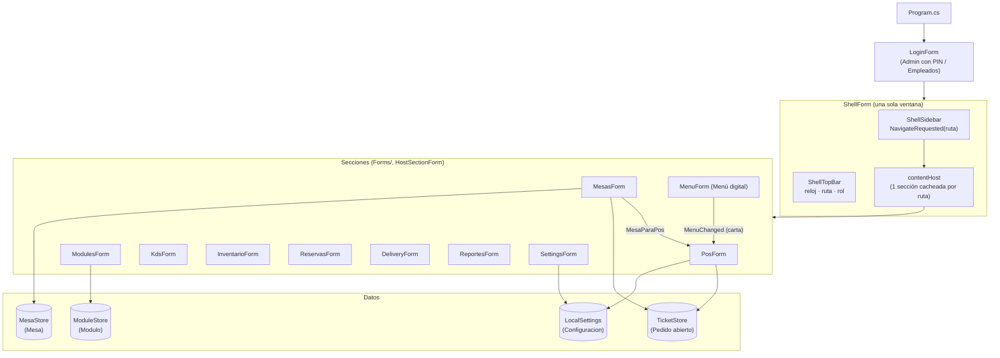

# RestoOS — Gestión de restaurantes (WinForms .NET 8, Windows)

Aplicación de escritorio para Windows para la gestión de restaurantes pequeños e independientes:
**POS + Mesas + Menú + KDS + Inventario + Reservas + Delivery + Reportes**, con módulos que el dueño
activa o desactiva, operación 100 % local y tema oscuro propio.

> **Estado: prototipo con base de datos SQL Server.** Carta, mesas, tickets, cobros, inventario, reservas,
> usuarios y configuración se guardan en SQL Server (ver [Persistencia](#persistencia)). KDS y Delivery siguen
> con datos de demostración. Ver también [Limitaciones conocidas](#limitaciones-conocidas).

Especificación de producto: [`requisitos-app-restaurante.md`](requisitos-app-restaurante.md).
Guía del kit visual: [`AppEscritorioWinForms/UI/LEEME_UI.md`](AppEscritorioWinForms/UI/LEEME_UI.md).

---

## Stack técnico

| Capa | Tecnología |
|---|---|
| UI | **Windows Forms sobre .NET 8** (`net8.0-windows`) |
| Lenguaje | C# (code-behind, sin MVVM / sin IoC) |
| Diseño | Todo editable en el **diseñador de Visual Studio** (controles propios en el Cuadro de herramientas) |
| Persistencia | **SQL Server** 2017+ (LocalDB o Express), base `RestoOS` — script en `Database/` |
| Dependencias externas | NuGet `Microsoft.Data.SqlClient` (sin ORM) |
| IDE / build | Visual Studio 2022 o superior (workload *Desarrollo de escritorio .NET*), `RestauranteGestor.sln` |
| SO objetivo | Windows 10 (1607+) y Windows 11 — requisito de .NET 8 (ver nota en [Limitaciones](#limitaciones-conocidas)) |

## Estructura del proyecto

```
Desktop/                                   ← raíz del repo (remote: MrDylanDev/Desktop)
├── README.md
├── requisitos-app-restaurante.md          ← spec de producto (§1–§13)
├── RestauranteGestor.sln / .slnx          ← solución (solo el proyecto WinForms)
├── Database/                              ← RestoOS_SQLServer.sql (crea la base) + ANALISIS_BD.md (diseño)
└── AppEscritorioWinForms/                 ← app actual: "app escritorio" (WinForms .NET 8)
    ├── Program.cs                         ← Base de datos → Login → ShellForm; "Cambiar perfil" vuelve al login
    ├── Shell/
    │   ├── ShellForm                      ← ventana principal: sidebar + barra superior + contenido
    │   ├── ShellSidebar                   ← menú lateral (Operación / Administración)
    │   └── ShellTopBar                    ← reloj, ruta, rol, "Cambiar perfil"
    ├── UI/                                ← kit visual (RButton, RPanel, RLabel, RTextBox, RComboBox, RSwitch,
    │   │                                    RChip, RDataGridView, RCalendar, RBarChart...)
    │   └── LEEME_UI.md                    ← cómo usar el kit y editar las secciones
    ├── Forms/                             ← UNA SECCIÓN = UN FORM (se ve la app completa en el diseñador):
    │                                        PosForm, MesasForm, MenuForm (Menú digital), KdsForm, InventarioForm,
    │                                        ReservasForm, DeliveryForm, ReportesForm, SettingsForm, ModulesForm
    │                                        + diálogos (Insumo, Reserva, Delivery, Categorías, Vincular insumo)
    │                                        + LoginForm, AdminCodeForm, OrderHistoryForm
    ├── Views/                             ← piezas reutilizables: ProductTile, TicketLineItem, TableCard,
    │                                        KdsOrderCard, ModuleCard, DishCard, DishImage, InsumoLinkRow,
    │                                        Checkout/Note/Receipt/TableDialog
    ├── Data/                              ← acceso a SQL Server: Db (conexión), Sesion, MenuStore, MesaStore, TicketStore,
    │                                        VentaStore, InsumoStore, ReservaStore, ModuleStore, LocalSettings
    ├── Models/                            ← MenuItem, Category, PosModels, ModuloModels
    └── Utils/Theme.cs                     ← paleta y tipografía únicas (copiadas de App.xaml de la versión WPF)
```

---

## Arquitectura



- **Una sección = un Form** (`Forms/PosForm`, `KdsForm`, `SettingsForm`...). Cada uno trae en su diseñador el
  `ShellSidebar` (con `ActiveRoute`), el `ShellTopBar` (con `RouteText`) y el contenido en `root`, así que al abrirlo
  en Visual Studio se ve **la app completa** y todo el contenido se edita con el mouse.
- **Una sola ventana al ejecutar:** `ShellForm.Navigate(ruta)` crea cada Form una vez, `HostSectionForm` le quita su
  sidebar y su barra (son copias para el diseñador) y lo muestra en `contentHost`. Sin parpadeo al navegar.
- **Todo es diseñable:** cada Form, tarjeta y diálogo tiene su `*.Designer.cs` limpio (sin lambdas ni código propio).

## Kit visual (`AppEscritorioWinForms/UI`)

Réplica en WinForms del tema de `App.xaml` de la versión WPF. Después de compilar, los controles aparecen en el
Cuadro de herramientas y se configuran desde Propiedades → categoría **RestoOS**.

| Control | Equivale en WPF | Propiedades clave |
|---|---|---|
| `RButton` | `PrimaryButton`, `SecondaryButton`, `DangerButton`, `NavButton`, `NumpadButton`, `IconButton` | `Variant`, `Selected`, `Compact` |
| `RPanel` / `RFlowPanel` | `Border` / `Style="Card"` / `WrapPanel` | `Surface`, `CornerRadius`, `BottomBorder` |
| `RLabel` | `TextBlock` | `TextStyle`, `ColorOverride` |
| `RTextBox` | `TextBox` con placeholder | `PlaceholderText`, `Multiline`, `LargeText` |
| `RComboBox` | `ComboBox` oscuro | `Items` |
| `RBadge` | chip (rol, "Operando local") | `Kind` |
| `RSwitch` | `CheckBox` "Módulo activado" | `Checked` |
| `RDataGridView` | `ListView`/`GridView` oscuro | columnas con `Tag = "chip"` / botones `"danger"`, `"primary"` |
| `RCalendar` / `RBarChart` | `Calendar` / barras de ventas | `SelectedDate` / `SetData(...)` |
| `RCardControl` | base para tarjetas propias | `Surface`, `HoverSurface`, `BorderColor` |
| `RDialogForm` | ventana de diálogo oscura | *Agregar → Formulario heredado* |

Colores y fuentes salen de `Utils/Theme.cs` (Surface `#111415`, Primary `#FFB59D`, Secondary `#FFB95F`,
Tertiary `#4EDEA3`...). Cambiar un color ahí lo cambia en toda la app. Barra de título y scrollbars oscuros en
Windows 10/11.

## Navegación y roles

| Perfil | Acceso |
|---|---|
| **Administrador** (usuario de prueba `Administrador`, PIN `1234`) | **Operación** (POS, Mesas, KDS, Inventario, Reservas, Delivery, Menú) **+ Administración** (Selector de Módulos, Reportes + Trazabilidad, Configuración). Entra a Módulos. |
| **Empleados** (cualquier usuario activo; de prueba `Caja 1`, PIN `0000`) | Solo **Operación**. Entra al POS. Reportes y Configuración bloqueados. |

- Atajos: **F1** POS · **F2** Mesas · **F3** Cocina KDS · **ESC** cierra el cobro.
- Los módulos apagados en el *Selector de Módulos* se deshabilitan en el menú al instante (tabla `Modulo`).
- El menú lateral se ajusta al alto de la pantalla (oculta la tarjeta de sucursal si no cabe) para no mostrar
  barra de desplazamiento.

## Flujo POS → cobro

```mermaid
sequenceDiagram
    actor M as Mesero/Cajero
    participant MV as MesasForm
    participant PV as PosForm
    participant CK as CheckoutDialog
    participant RC as ReceiptDialog
    M->>MV: "Abrir en POS"
    MV->>PV: MesaParaPos → SetMesa()
    M->>PV: + producto / nota / − + ×
    PV->>PV: RefreshTicket() (guarda el Pedido abierto; subtotal + impuesto de Configuración)
    M->>PV: COBRAR
    PV->>CK: total + mesa / para llevar / domicilio
    CK->>CK: Efectivo (numpad o teclado + vuelto) / Tarjeta (monto exacto)
    CK-->>PV: PaymentConfirmed + método
    PV->>PV: VentaStore.Cobrar → sp_CobrarPedido (venta, pago, insumos, porciones, mesa "Por limpiar")
    PV->>RC: vista previa con N.º de venta + Imprimir (impresora de Windows)
    PV->>PV: vacía el ticket
```

- Tickets por mesa en `Data/TicketStore`: cada ticket es un `Pedido` abierto en la base (sobrevive a cierres y cortes de luz).
  La mesa pasa a "Ocupada" con el primer producto y a "Por limpiar" al cobrar.
- Notas por ítem ("sin cebolla"), impuesto Exento 0 % / INC 8 % / IVA 19 % (por defecto el de Configuración),
  panel de domicilio propio cuando el módulo Delivery está activo.

## Estado por módulo

| Módulo | Pantalla | Lógica | Persiste |
|---|---|---|---|
| POS | `PosForm` (kit UI) | Ticket por mesa, notas, impuesto, cobro, recibo | Sí: `Pedido`, `DetallePedido`, `Venta`, `Pago` |
| Mesas y Salón | `MesasForm` (kit UI) | CRUD, filtro por salón, detalle, abrir en POS | Sí: `Mesa`, `Sector` |
| Selector de Módulos | `ModulesForm` (kit UI) | Tarjetas `ModuleCard` con interruptor | Sí: `Modulo` |
| Menú digital | `MenuForm` (kit UI) | Tarjetas con foto y estado, filtros, búsqueda por ingrediente/alérgeno, edición rápida, etiquetas dietéticas, insumos vinculados, pausa por falta de stock, duplicar, reordenar arrastrando. Alimenta al POS | Sí: `Categoria`, `Producto`, `Etiqueta`, `ProductoInsumo` |
| Configuración | `SettingsForm` (kit UI) | Datos del negocio, impuesto por defecto, respaldo de la base | Sí: `Configuracion` + archivos `.bak` |
| Cocina KDS | `KdsForm` (kit UI) | Kanban 3 columnas, estaciones, tiempos (DEMO) | No |
| Inventario | `InventarioForm` (kit UI) | CRUD + alertas de stock; cada venta descuenta según la receta | Sí: `Insumo`, `MovimientoInventario` |
| Reservas | `ReservasForm` (kit UI) | Calendario + agenda + CRUD | Sí: `Reserva`, `Cliente` |
| Delivery | `DeliveryForm` (kit UI) | Cola por plataforma, estados, CRUD (DEMO) | No |
| Reportes | `ReportesForm` (kit UI) | KPIs, gráfico 7 días, top platos, por mesa, historial y anulación con PIN de administrador | Lee `Venta` |
| DIAN / Delivery real | Pendiente (Fase 3) | — | — |

## Persistencia

Todo se guarda en la base **`RestoOS`** de SQL Server. Diseño completo (tablas, reglas, procedimientos) en
[`Database/ANALISIS_BD.md`](Database/ANALISIS_BD.md).

- **Primera ejecución:** la app crea la base sola con el script embebido `Database/RestoOS_SQLServer.sql`
  (carta de ejemplo, 10 mesas, insumos y usuarios de prueba).
- **Conexión:** por defecto `(localdb)\MSSQLLocalDB` (viene con Visual Studio). Para otro servidor, escribe la cadena
  de conexión en `%LocalAppData%\RestoOS\conexion.txt`, por ejemplo
  `Server=.\SQLEXPRESS;Database=RestoOS;Integrated Security=true;TrustServerCertificate=true`.
- **Respaldos:** Configuración → "Crear respaldo ahora" genera un `.bak` en `%LocalAppData%\RestoOS\backups\`.
- Si la base no tiene platos y existe la carta vieja `data\menu.xml`, se importa una vez.

## Compilar y ejecutar

Requisitos: Windows 10/11 + Visual Studio 2022 o superior con el workload **Desarrollo de escritorio .NET** (.NET 8 SDK)
y **SQL Server Express LocalDB** (se instala con ese workload; si no, desde el instalador de Visual Studio o de SQL Server Express).

1. Abrir `RestauranteGestor.sln` (o `.slnx`) y compilar (**Ctrl+Shift+B**). La primera vez descarga el paquete NuGet `Microsoft.Data.SqlClient`.
2. Ejecutar con **F5**. La primera vez crea la base. Usuarios de prueba: `Administrador` PIN `1234`, `Caja 1` PIN `0000`
   (cámbialos con `EXEC dbo.sp_GuardarPin`).

Por consola:

```powershell
dotnet build "AppEscritorioWinForms\app escritorio.csproj"
dotnet run --project "AppEscritorioWinForms\app escritorio.csproj"
```

> Para editar una sección: compilar una vez y abrir su Form en `Forms/` con doble clic (diseñador). Reglas para no romper el
> diseñador en [`UI/LEEME_UI.md`](AppEscritorioWinForms/UI/LEEME_UI.md).

## Limitaciones conocidas

1. **SQL Server en vez de SQLite** (spec §5): cada equipo necesita LocalDB o SQL Server Express. A cambio permite varias cajas en red.
2. **.NET 8 no corre en Windows 8/8.1** (mínimo Windows 10 1607). La spec (§4) pide compatibilidad desde Windows 8;
   la versión WPF anterior (.NET Framework 4.8) sí la cumplía. Decisión pendiente.
3. El POS cobra siempre el precio de salón (aún no usa el precio de delivery en pedidos a domicilio).
4. Las fotos de los platos se guardan como ruta a un archivo del equipo.
5. KDS y Delivery usan datos de demostración (el POS aún no envía comandas a cocina; la base ya tiene `Comanda` y `sp_EnviarComandas`).
6. Los roles Cajero, Mesero y Cocina existen en la base (`RolModulo`), pero la app todavía solo distingue Administrador / Empleados.
   No hay pantalla para crear usuarios (se hace en SQL).
7. El cobro admite un solo método por venta desde la UI; la base ya acepta pago dividido/mixto (`Pago`).
8. Sin tests, sin logging, sin respaldo automático.

## Historial

- **Versión WPF (.NET Framework 4.8)** — `RestauranteGestor.Native/`. Primera interfaz completa con tema oscuro;
  sirvió de referencia visual. Se quitó del repositorio (sigue en el historial de git).
- **Versión WinForms (.NET 8)** — `AppEscritorioWinForms/`. Migración de todos los módulos a WinForms (partiendo del
  editor de carta de David), ventana principal única, kit visual con el mismo look de la versión WPF y pantallas
  editables en el diseñador de Visual Studio.
